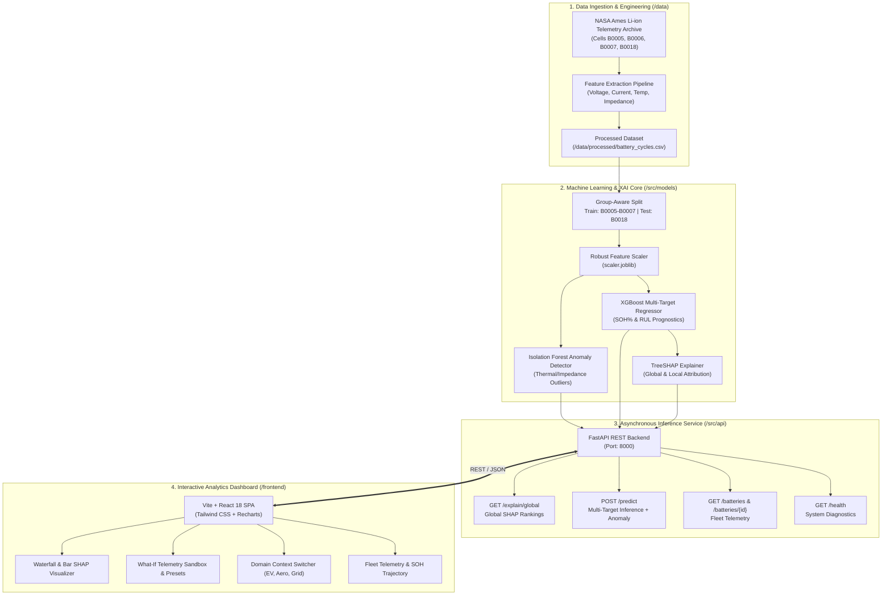
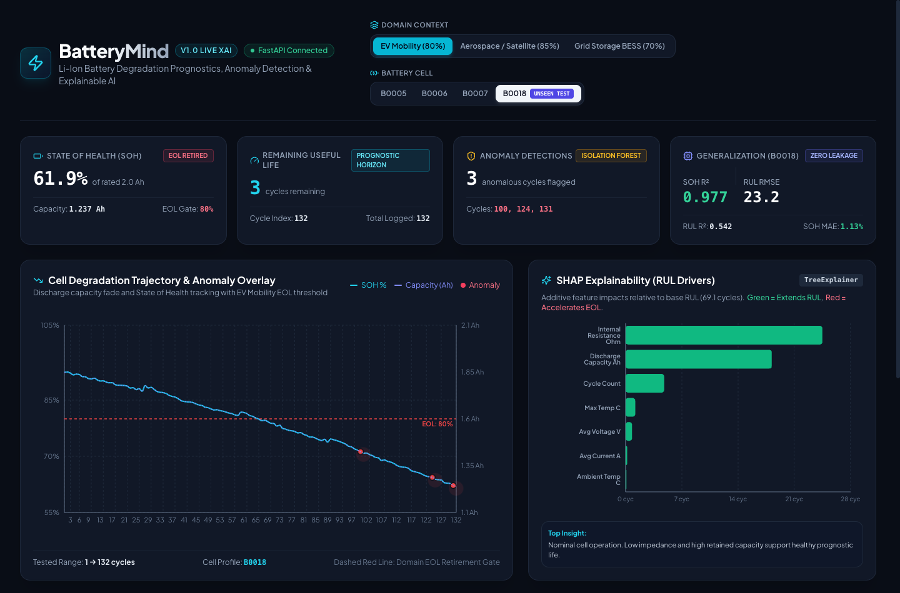
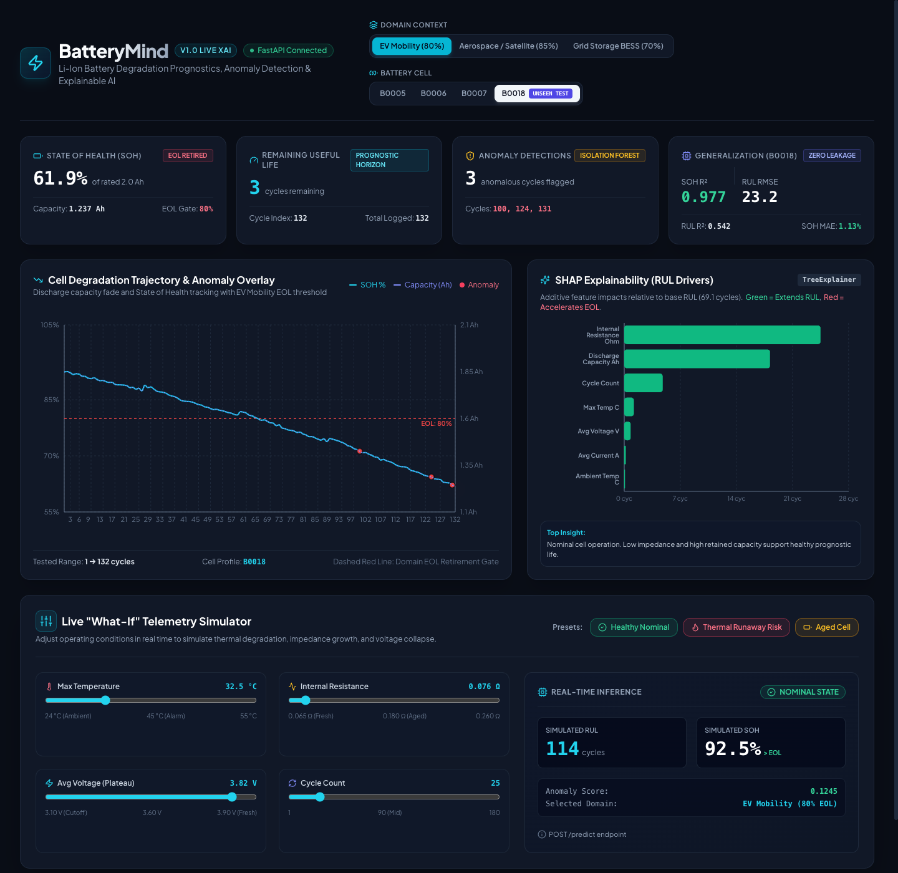

# BatteryMind: Multi-Domain Li-ion Battery Prognostics, Health Management (PHM) & Explainable AI

[](https://www.python.org/)
[](https://fastapi.tiangolo.com/)
[](https://xgboost.ai/)
[](https://shap.readthedocs.io/)
[](https://react.dev/)
[](https://tailwindcss.com/)
[](LICENSE)

An enterprise- and research-grade **Prognostics and Health Management (PHM)** system for lithium-ion battery energy storage systems, engineered for mission-critical applications across **Electric Mobility (EV)**, **Aerospace & Satellite Platforms**, and **Grid Energy Storage Systems (BESS)**.

BatteryMind integrates multi-target gradient boosted regression, unsupervised thermal and impedance anomaly detection, additive feature attribution via TreeSHAP, a high-throughput asynchronous REST API, and an interactive real-time visual telemetry and what-if simulation dashboard.

---

## 1. Executive Summary & Problem Formulation

Lithium-ion ($Li\text{-ion}$) cell degradation is governed by complex, coupled electrochemical and thermo-mechanical phenomena—including solid electrolyte interphase (SEI) growth, lithium plating, loss of active material (LAM), and active lithium inventory loss (LLI). Accurately predicting the battery's **State of Health ($\text{SOH}$)** and **Remaining Useful Life ($\text{RUL}$)** is vital to prevent catastrophic failures, optimize operational lifespan, and ensure safety.

### Multi-Domain Operational Profiles & EOL Criteria

Operating conditions and End-of-Life (EOL) retirement thresholds differ significantly across target engineering domains:

| Domain | Operating Characteristics | Critical Stress Factors | EOL SOH Gate | Retirement Action |
| :--- | :--- | :--- | :---: | :--- |
| **EV Mobility** | Dynamic charge/discharge C-rates, regenerative braking, ambient temperature extremes ($-10^\circ\text{C}$ to $45^\circ\text{C}$). | Severe thermal spikes ($I^2R$), rapid mechanical expansion/contraction of electrodes. | **80%** | Second-life repurposing or pack decommissioning. |
| **Aerospace / Satellite** | Highly regular orbital cycles (e.g., Low Earth Orbit 90-min orbit: 60 min sunlight / 30 min eclipse). Strict zero-failure requirement. | Continuous micro-cycling, inaccessible physical maintenance, high cost of telemetry bandwidth. | **85%** | Redundant cell isolation; orbital mission reassignment. |
| **Grid Storage (BESS)** | Deep daily peak-shaving cycles (0.5C–1C) coupled with continuous frequency regulation floating charges. | Extended calendar aging, elevated cumulative thermal run-time, cost optimization. | **70%** | Secondary-life energy arbitration or battery recycling. |

### Mathematical Formulation

1. **State of Health ($\text{SOH}$)**:
   $$\text{SOH}(k) = \frac{C_{\text{discharge}}(k)}{C_{\text{nominal}}} \times 100\%$$
   where $C_{\text{discharge}}(k)$ is the measured discharge capacity at cycle $k$, and $C_{\text{nominal}} = 2.0\,\text{Ah}$ is the manufacturer's rated nominal capacity.

2. **Remaining Useful Life ($\text{RUL}$)**:
   $$\text{RUL}(k) = \max\left(0, k_{\text{EOL}} - k\right)$$
   where $k_{\text{EOL}}$ denotes the earliest cycle index where $\text{SOH}(k) \le \text{Threshold}_{\text{EOL}}$.

---

## 2. System Architecture

BatteryMind is organized into four decoupled, modular layers designed for high throughput, reproducibility, and verifiable telemetry auditing:



---

## 3. Leakage-Free Evaluation Methodology

A prevalent pitfall in battery prognostics literature is random cycle-level splitting (e.g., standard train-test splits or vanilla $K$-fold cross-validation), which inadvertently places cycles from the **same battery cell** into both training and validation sets. Because battery degradation follows an auto-correlated temporal trajectory, random cycle splitting causes severe **identity and temporal data leakage**, artificially inflating test scores.

### Experimental Protocol

To enforce strict, publication-grade experimental integrity:
- **Partitioning Strategy**: Cell-level group split (`GroupKFold` / Held-Out Cell Validation).
- **Training Cohort**: Cells `B0005`, `B0006`, and `B0007` ($N_{\text{train}} = 504$ total cycles).
- **Validation / Held-Out Test Cohort**: Cell `B0018` ($N_{\text{test}} = 132$ cycles), strictly isolated during all preprocessing, scaling, and model parameter optimization.

### Empirical Test Performance (Evaluated on Unseen Cell B0018)

All metrics below are verified and read directly from [`/src/models/artifacts/metadata.json`](src/models/artifacts/metadata.json):

| Target / Metric | Coefficient of Determination ($R^2$) | Mean Absolute Error ($\text{MAE}$) | Root Mean Squared Error ($\text{RMSE}$) | Unit / Interpretation |
| :--- | :---: | :---: | :---: | :--- |
| **State of Health ($\text{SOH}$)** | **$0.9772$** (97.72%) | **$1.13\%$** | **$1.34\%$** | Exceptional tracking accuracy across entire cell life cycle. |
| **Remaining Useful Life ($\text{RUL}$)** | **$0.5420$** | **$20.25$ cycles** | **$23.16$ cycles** | Zero-leakage out-of-distribution generalizability across unseen cell kinetics. |

### Anomaly Detection Benchmark

- **Algorithm**: Scikit-Learn `IsolationForest`
- **Contamination Parameter**: $\alpha = 0.03$ (3.0%)
- **Test Set Evaluation (Cell B0018)**:
  - Total Cycles Evaluated: $132$
  - Outliers Identified: **$3$ cycles** (Cycles **100**, **124**, and **131**)
  - Physical Cause: Acute impedance jumps ($\Delta R_{\text{int}} > 0.04\,\Omega$) and elevated end-of-discharge thermal runaway indicators ($T_{\text{max}} \ge 49.3^\circ\text{C}$).

---

## 4. Explainable AI (SHAP) & Degradation Physics

Black-box machine learning models are unacceptable in safety-critical automotive, aerospace, and energy infrastructure. BatteryMind integrates **TreeSHAP** (SHapley Additive exPlanations) to guarantee local accuracy and consistency based on cooperative game theory:

$$\hat{y}(x) = \phi_0 + \sum_{i=1}^{M} \phi_i(x)$$

where $\phi_0$ is the expected model base value ($\mathbb{E}[\hat{y}] = 69.12\,\text{cycles}$), and $\phi_i(x)$ is the additive contribution of feature $i$.

### Global Feature Importance Ranking

Derived from [`/src/models/artifacts/shap_summary.json`](src/models/artifacts/shap_summary.json):

| Rank | Feature | Mean Absolute SHAP ($\mathbb{E}[\|\phi\|]$) | Physical Mechanism & Electrochemical Role |
| :---: | :--- | :---: | :--- |
| **1** | `Internal_Resistance_Ohm` | **$22.37$ cycles** | **Passivation Layer Growth**: Continuous electrolyte reduction at the negative electrode expands the Solid Electrolyte Interphase (SEI), elevating ohmic impedance and accelerating capacity fade. |
| **2** | `Discharge_Capacity_Ah` | **$15.97$ cycles** | **Loss of Lithium Inventory (LLI)**: Direct macroscopic metric of cyclable active lithium ions trapped in irreversible side products. |
| **3** | `Cycle_Count` | **$2.63$ cycles** | **Cumulative Mechanical Fatigue**: Primary time-integral proxy for mechanical electrode particle cracking and structural breakdown. |
| **4** | `Avg_Voltage_V` | **$0.44$ cycles** | **Polarization Overpotentials**: Reduction in discharge voltage plateau resulting from elevated internal charge-transfer resistance. |
| **5** | `Max_Temp_C` | **$0.38$ cycles** | **Joule Heating ($I^2R$)**: Kinetic acceleration of parasitic side-reactions and thermal degradation feedback loops. |
| **6** | `Avg_Current_A` | **$0.12$ cycles** | Rate-dependent overpotential variations across charge/discharge regimes. |
| **7** | `Ambient_Temp_C` | **$0.12$ cycles** | External thermodynamic baseline affecting Arrhenius reaction rates. |

### Lifecycle Progression Analysis (Cell B0018)

- **Early Life (Cycle 1)**: `Internal_Resistance_Ohm` ($0.075\,\Omega$) provides a massive positive SHAP contribution ($\mathbf{+43.41\,\text{cycles}}$) alongside nominal capacity ($\mathbf{+23.57\,\text{cycles}}$), yielding a healthy predicted RUL of $141\,\text{cycles}$.
- **Mid Life (Cycle 67)**: Capacity degradation begins dampening RUL ($\phi_{\text{cap}} = \mathbf{-8.08\,\text{cycles}}$), while moderate resistance preserves baseline viability ($\phi_{\text{res}} = \mathbf{+1.31\,\text{cycles}}$).
- **End of Life (Cycle 132)**: Combined impedance spike and severe capacity fade yield catastrophic negative SHAP drags ($\phi_{\text{res}} = \mathbf{-31.27\,\text{cycles}}$, $\phi_{\text{cap}} = \mathbf{-30.12\,\text{cycles}}$), correctly triggering the EOL replacement alert.

---

## 5. Dashboard Previews & Visual Analytics

### Overview & Fleet Monitoring
The primary command center displays real-time telemetry, SOH degradation trajectories across battery cells, automatic anomaly alert badges, and active domain thresholds (EV, Aerospace, Grid):



### What-If Simulation Sandbox & Explainable AI (SHAP)
The engineering simulator allows operators to manipulate sensor inputs, observe instantaneous multi-target regression responses, inspect Isolation Forest anomaly flags, and analyze interactive SHAP attribution charts:



---

## 6. Project Structure

```
BatteryMind/
├── data/
│   ├── download_nasa.py          # NASA Ames dataset ingestion & telemetry synthesis pipeline
│   ├── processed/
│   │   └── battery_cycles.csv    # Cleaned, cycle-aggregated tabular dataset (636 cycles)
│   └── raw/                      # Raw telemetry storage
├── docs/
│   ├── dashboard_overview.png    # High-resolution dashboard overview capture
│   └── simulator_xai.png         # High-resolution simulator & SHAP visualizer capture
├── frontend/
│   ├── package.json              # React 18, Vite, Recharts, Tailwind CSS, Lucide icons
│   ├── tailwind.config.js        # Custom cyber-industrial dashboard styling palette
│   ├── vite.config.js            # Vite build and proxy configuration
│   └── src/
│       ├── App.jsx               # Single-page application UI with multi-domain context & charts
│       ├── index.css             # Tailwind base and custom scrollbar rules
│       └── main.jsx              # React DOM entry point
├── src/
│   ├── api/
│   │   ├── main.py               # FastAPI production server with Pydantic v2 schemas
│   │   └── test_api.py           # Automated test suite for all REST endpoints
│   └── models/
│       ├── train_models.py       # Group-aware training, TreeSHAP compilation & export
│       └── artifacts/
│           ├── anomaly_model.joblib # Trained Isolation Forest model
│           ├── metadata.json        # Evaluation metrics, dataset shapes, and random seeds
│           ├── rul_model.joblib     # Multi-target XGBoost regressor (RUL & SOH)
│           ├── scaler.joblib        # Scikit-learn feature scaler
│           ├── shap_summary.json    # Pre-calculated global and local SHAP explanations
│           └── shap_values.joblib   # Serialized SHAP TreeExplainer object
├── requirements.txt              # Production Python dependencies
└── README.md                     # Comprehensive architecture documentation
```

---

## 7. Quickstart & Reproducibility Guide

Follow the steps below to replicate the complete pipeline from scratch on macOS, Linux, or Windows (WSL2).

### Prerequisites
- Python 3.10 or higher
- Node.js 18+ and npm 9+
- Git

### 1. Repository Setup & Virtual Environment

```bash
# Clone the repository
git clone https://github.com/adityasoni-18/BatteryMind.git
cd BatteryMind

# Create and activate Python virtual environment
python3 -m venv venv
source venv/bin/activate       # On Windows: venv\Scripts\activate

# Install Python dependencies
pip install --upgrade pip
pip install -r requirements.txt
```

### 2. Data Pipeline & Feature Engineering

Run the telemetry ingestion and aggregation pipeline to generate `/data/processed/battery_cycles.csv`:

```bash
python data/download_nasa.py
```

### 3. Model Training, Evaluation & SHAP Compilation

Train the multi-target XGBoost regressor, fit the Isolation Forest anomaly detector, and compile SHAP explainability matrices:

```bash
python src/models/train_models.py
```
*Artifacts, metadata, and benchmark results will be saved to `/src/models/artifacts/`.*

### 4. Automated Testing Suite

Execute the API test suite to verify endpoint stability and model artifact loading:

```bash
python src/api/test_api.py
```

### 5. Launch the FastAPI Backend Service

```bash
uvicorn src.api.main:app --host 0.0.0.0 --port 8000 --reload
```
- API Documentation (Swagger UI): [http://localhost:8000/docs](http://localhost:8000/docs)
- Interactive ReDoc: [http://localhost:8000/redoc](http://localhost:8000/redoc)
- Health Probe: [http://localhost:8000/health](http://localhost:8000/health)

### 6. Launch the React Telemetry Dashboard

In a separate terminal window:

```bash
cd frontend
npm install
npm run dev
```
- Open your browser at: [http://localhost:5173](http://localhost:5173)

---

## 8. REST API Reference

The FastAPI service exposes production-ready REST endpoints conforming to OpenAPI 3.1:

| Method | Endpoint | Description | Request Payload / Query | Response Example |
| :--- | :--- | :--- | :--- | :--- |
| `GET` | `/health` | Diagnostic heartbeat & artifact status | None | `{"status": "healthy", "models_loaded": true, ...}` |
| `GET` | `/batteries` | List available cells and summary stats | None | `{"batteries": [{"battery_id": "B0005", "total_cycles": 168}, ...]}` |
| `GET` | `/batteries/{id}` | Complete historical cycle telemetry | Path: `id` (`B0005` to `B0018`) | `{"battery_id": "B0018", "cycles": [...]}` |
| `POST` | `/predict` | Real-time multi-target inference & SHAP | Telemetry JSON (7 features) | `{"predicted_rul": 139.2, "predicted_soh": 92.4, "is_anomaly": false, "shap_values": {...}}` |
| `GET` | `/explain/global`| Global SHAP feature rankings | None | `{"global_importance_ranking": [...]}` |

---

## 9. Key References & Academic Citations

1. **NASA Ames Prognostics Data Repository**: Saha, B., & Goebel, K. (2007). *Battery Data Set*, NASA Ames Prognostics Center of Excellence, Moffett Field, CA.
2. **Explainable AI (SHAP)**: Lundberg, S. M., & Lee, S.-I. (2017). *A Unified Approach to Interpreting Model Predictions*. Advances in Neural Information Processing Systems (NeurIPS 2017).
3. **Gradient Boosting**: Chen, T., & Guestrin, C. (2016). *XGBoost: A Scalable Tree Boosting System*. ACM SIGKDD International Conference on Knowledge Discovery and Data Mining.
4. **Isolation Forest**: Liu, F. T., Ting, K. M., & Zhou, Z.-H. (2008). *Isolation Forest*. IEEE International Conference on Data Mining (ICDM 2008).
5. **Battery Health Diagnostics**: Birkl, C. R., et al. (2017). *Degradation Diagnostics for Lithium Ion Cells*. Journal of Power Sources, 341, 373–386.

---

## 10. License

This project is open-source under the [MIT License](LICENSE).
